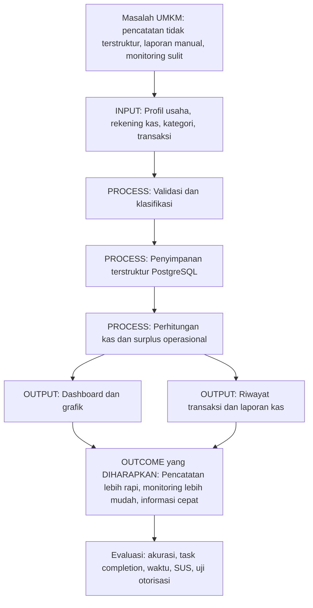

# Kerangka Konseptual UsahaCerdas

Kerangka pengembangan menggunakan **Input — Process — Output — Outcome (IPOO)**. Indikator outcome perlu diuji pada pengguna nyata.

## Operasionalisasi

| Komponen | Indikator | Pengukuran |
|---|---|---|
| Input | Kelengkapan transaksi | Persentase field wajib yang valid |
| Proses | Akurasi agregasi | Bandingkan hasil sistem dan perhitungan referensi |
| Output | Ketersediaan informasi | Apakah informasi saldo, pemasukan, pengeluaran muncul benar |
| Outcome | Efisiensi | Waktu pengguna menyelesaikan tugas sebelum/sesudah |
| Outcome | Usability | SUS dan penyelesaian skenario |

## Kaidah pencatatan

- Surplus operasional berbasis kas = pemasukan operasional − pengeluaran operasional periode tersebut.
- Perubahan kas = income + setoran modal − expense − prive; transfer antarkas tidak mengubah total kas.
- Saldo kas total = total saldo awal akun + perubahan kas sampai tanggal acuan.
- Surplus operasional **bukan** laba akrual lengkap atau laba setelah HPP bila stok belum dikelola.
